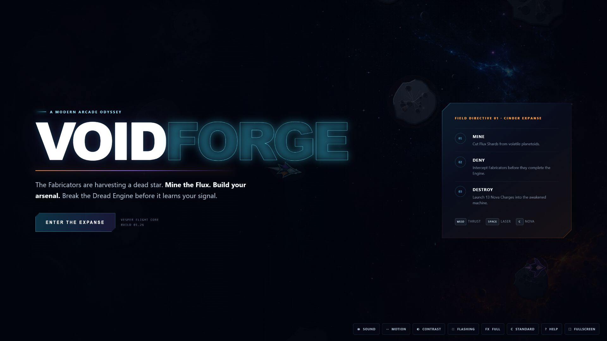

# VOIDFORGE



VOIDFORGE is an original, high-resolution multidirectional arcade shooter for desktop browsers. Mine Flux Shards, stop Fabricators from assembling the Dread Engine, survive its pursuit, and destroy it with homing Nova Charges.

All artwork, silhouettes, names, dialogue, procedural audio, music, and code are original. The clean-room design boundaries are documented in [IMPLEMENTATION_NOTES.md](IMPLEMENTATION_NOTES.md).

## Play locally

Requires Node.js 22.13 or newer.

```bash
npm install
npm run dev
```

Open the local URL printed by Vite. For a production build:

```bash
npm run build
npm run start
```

## Controls

| Action | Keyboard | Standard gamepad |
| --- | --- | --- |
| Thrust and steer | WASD or arrow keys | Left stick |
| Fire laser / mine | Space | South face button |
| Launch Nova Charge | C or Shift | East or west face button |
| Pause / resume | P or Escape | Menu button |
| Start | Enter or on-screen button | — |
| Restart after game over | R or on-screen button | — |

Laser fire mines planetoids as well as attacking enemies. Controlled bursts release more Flux; firing too rapidly can destroy a planetoid before all its shards are extracted.

## Accessibility and display

The utility bar provides independent reduced-motion and reduced-flashing controls, effect-density presets including FX Off, deuteranopia/protanopia/tritanopia color profiles, High Contrast, procedural-audio mute, in-game help, and fullscreen controls. Reduced motion and flashing follow the operating system preference on first launch. Preferences are saved locally. Critical states use text, distinct silhouettes, HUD meters, scanner shapes, and audio rather than color alone.

The renderer targets 60 FPS at 1920×1080 and scales responsively through 3840×2160. A live 4K bombardment profile recorded 60 FPS average with a 16.8 ms p95 frame time; see the [performance capture](artifacts/performance-3840x2160.json).

Ordered WebGL layers separate the Vesper and both friendly and hostile shots from terrain, pickups, enemies, and decorative effects, keeping them readable during dense combat. The player, enemies, planetoids, and Dread Engine now use rebuilt, material-rich art with illuminated panels, fractured mineral surfaces, and layered mechanical depth. Directional speed streaks, far-debris/dust/star parallax, articulated motion, persistent damage, and threat-aware camera lead and zoom add depth without changing the playfield's arcade clarity.

Typed spark, shard, smoke, and plasma systems create distinct silhouettes, joined by expanding impact rings and shockwave distortion. The WebGL post-processing pipeline adds restrained heat refraction, selective two-tap bloom, split-tone grading, danger cues, and scene-wide color-vision transforms. Reduced Motion, Reduced Flashing, effect intensity, and FX Off scale or disable these treatments immediately while retaining essential gameplay feedback.

## Architecture

- `app/game/VoidforgeGame.tsx` — PixiJS WebGL renderer, simulation, entities, camera, input, HUD, and deterministic showcase scenes
- `app/game/postfx.ts` — one-pass custom WebGL post-processing and scene-wide accessibility color transforms
- `app/game/audio.ts` — original Web Audio synthesis, spatial effects, engine layers, warnings, and impacts
- `app/game/core.mjs` — testable rules for mining, construction, homing, collisions, boss damage, and progression
- `app/globals.css` — responsive widescreen interface, overlays, HUD, accessibility states, and 4K scaling
- `tests/` — deterministic mechanic tests and production-render smoke tests
- `artifacts/screenshots/` — the eight required gameplay states at both 1080p and native 4K
- `RESEARCH.md`, `GAME_SPEC.md`, and `IMPLEMENTATION_NOTES.md` — research boundaries, game specification, and clean-room decisions

PixiJS loads only in the browser. The surrounding React/vinext application server-renders the launch interface, while gameplay graphics use high-resolution WebGL primitives over an original generated cosmic background.

## Verification

```bash
npm test
npm run lint
```

Deterministic visual states are available at `/?showcase=exploration`, `mining`, `construction`, `combat`, `pursuit`, `bombardment`, `destruction`, and `gameover`.

| Scene | 1920×1080 | 3840×2160 |
| --- | --- | --- |
| Exploration | [View](artifacts/screenshots/01-exploration-1920x1080.png) | [View](artifacts/screenshots/01-exploration-3840x2160.jpg) |
| Mining and collection | [View](artifacts/screenshots/02-mining-1920x1080.png) | [View](artifacts/screenshots/02-mining-3840x2160.jpg) |
| Construction | [View](artifacts/screenshots/03-construction-1920x1080.png) | [View](artifacts/screenshots/03-construction-3840x2160.jpg) |
| Dense combat | [View](artifacts/screenshots/04-combat-1920x1080.png) | [View](artifacts/screenshots/04-combat-3840x2160.jpg) |
| Pursuit | [View](artifacts/screenshots/05-pursuit-1920x1080.png) | [View](artifacts/screenshots/05-pursuit-3840x2160.jpg) |
| Nova bombardment | [View](artifacts/screenshots/06-bombardment-1920x1080.png) | [View](artifacts/screenshots/06-bombardment-3840x2160.jpg) |
| Dread Engine destruction | [View](artifacts/screenshots/07-destruction-1920x1080.png) | [View](artifacts/screenshots/07-destruction-3840x2160.jpg) |
| Game over | [View](artifacts/screenshots/08-gameover-1920x1080.png) | [View](artifacts/screenshots/08-gameover-3840x2160.jpg) |
